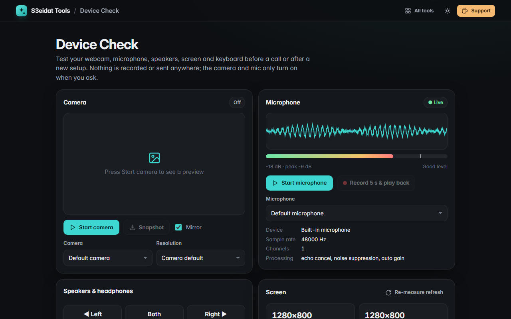

# Device Check

> Test your webcam, microphone, speakers, screen and keyboard. Free, private, and it runs entirely in your browser.

### ▶ [Open Device Check](https://s3eidat.github.io/device-check/)



## Features

- **Camera**: live preview, camera picker, resolution choice (480p to 4K), actual resolution and aspect ratio,
  **measured frame rate**, mirror, and a full-resolution **snapshot** download
- **Microphone**: live waveform, **level meter** with peak hold and dB, "too quiet / clipping" hints, mic picker,
  sample rate and processing info, and **record 5 seconds and play it back**
- **Speakers & headphones**: **left / both / right** test chimes and a 20 Hz → 20 kHz **frequency sweep**
- **Screen**: resolution, physical pixels, **pixel ratio**, **refresh rate** (measured), available area, window size,
  colour depth and gamut, HDR, orientation, touch points, pointer type
- **Keyboard tester**: an on-screen keyboard lights up every key you press, shows `key`, `code` and `keyCode`,
  counts tested keys and lists keys outside the layout

## Privacy

Everything happens in the page. The camera and microphone only start when you press their buttons, and
nothing is recorded except the 5-second mic test, which stays in the tab. There is no server, no account,
no analytics. The page ships with a strict Content-Security-Policy (`connect-src 'self'`), so the browser
itself blocks any attempt to send data anywhere.

## Run it yourself

It's plain HTML, CSS and JavaScript with no build step:

```bash
git clone https://github.com/s3eidat/device-check
cd device-check
python -m http.server 8000
```

Then open http://localhost:8000 (camera and mic need `localhost` or HTTPS).

## Support

If this saved you time, **[buy me a coffee ☕](https://s3eidat.github.io/coffee/)**. It keeps every tool free.

---

Part of **[S3eidat Tools](https://s3eidat.github.io/)**: 100+ free, private tools that run in your browser. MIT licensed.
